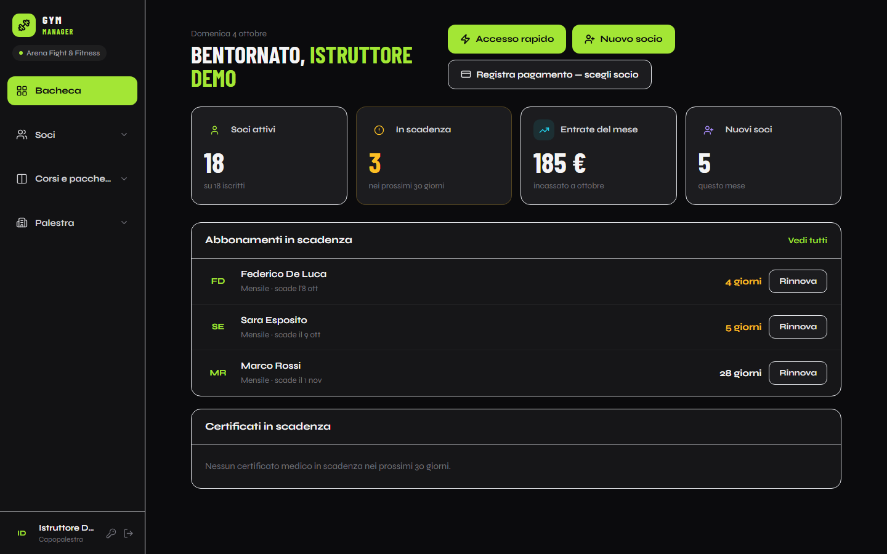
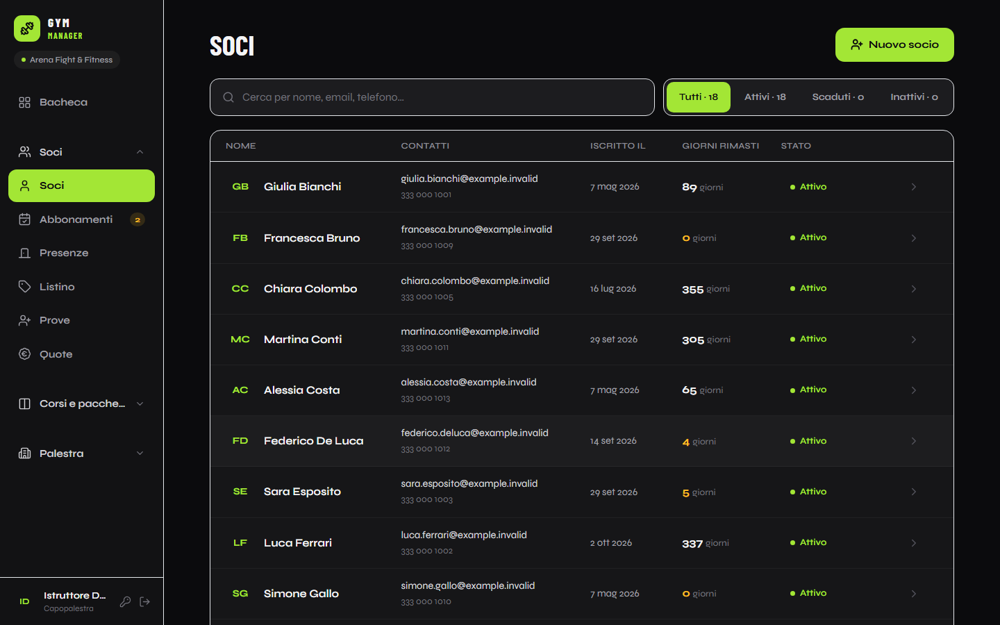
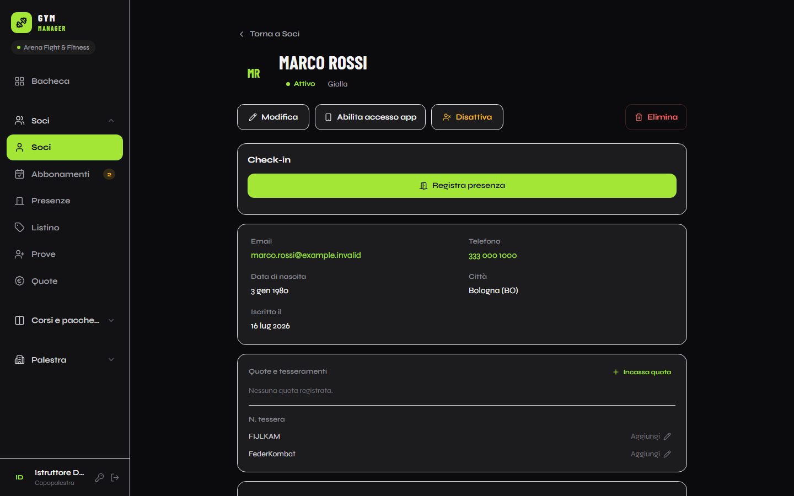
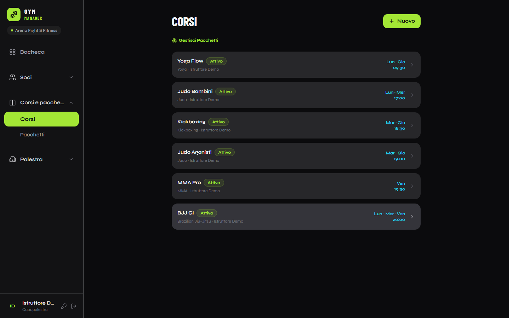
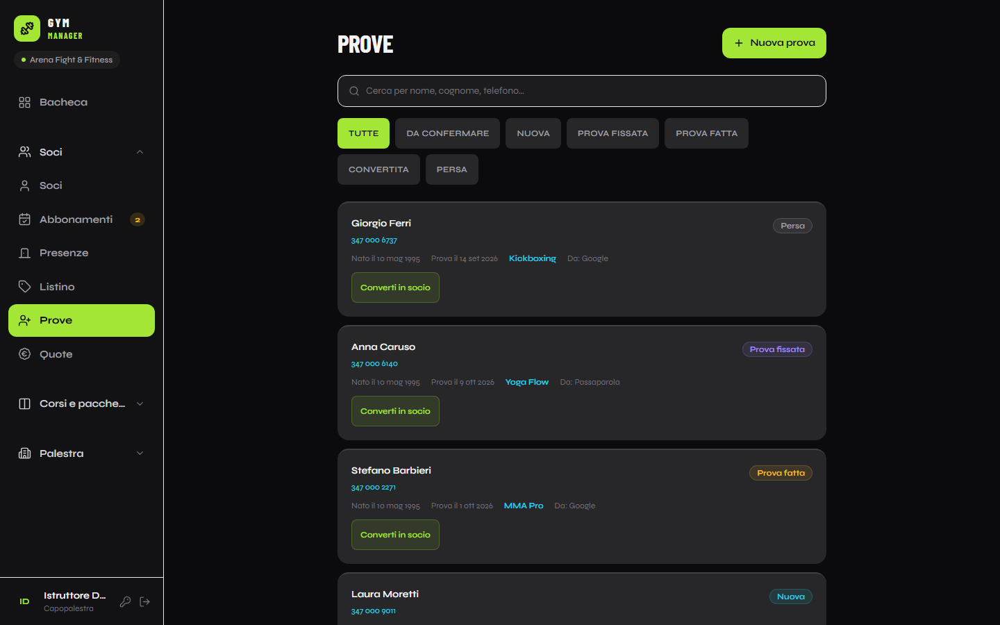
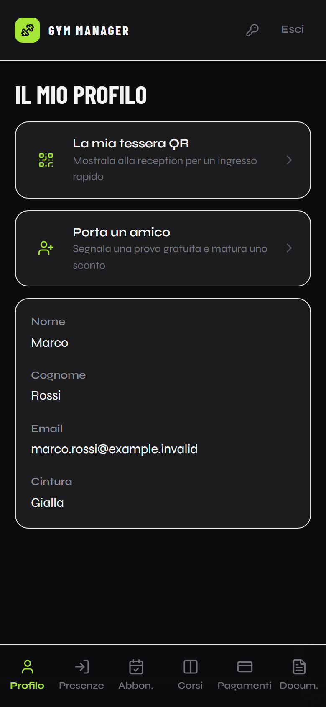

# Arena — Gym Manager

**Il gestionale per palestre multidisciplinari.**

Gestionale web **multi-palestra** per palestre e associazioni sportive multidisciplinari (arti
marziali, lotta, yoga, MMA…): anagrafica soci, abbonamenti e pagamenti, check-in con QR code,
corsi e presenze, quote associative e tesseramenti federali, prove gratuite e promemoria email
automatici. È in produzione presso una palestra reale.

| | |
|---|---|
| **Backend** | Java 21 · Spring Boot 3.2 · Spring Security + JWT · JPA/Hibernate · PostgreSQL |
| **Frontend** | React 19 · TypeScript · Vite · TanStack Query · Zustand · Tailwind CSS · PWA |
| **Qualità** | 246 test di integrazione con Testcontainers · CI GitHub Actions · load test k6 |
| **Infrastruttura** | Docker · Caddy (HTTPS) · Cloudflare · Postgres in container con backup notturni |

## Screenshot

*Dati di esempio inventati.*



| Soci | Scheda socio |
|---|---|
|  |  |
| **Corsi** | **Prove gratuite** |
|  |  |

**Da telefono** — bacheca della reception, area del socio e tessera QR per il check-in:

<p>
  
  
  
</p>

Altre schermate: [presenze del giorno](docs/screenshots/check-in.png).

## Funzionalità

**Multi-tenant e ruoli.** Ogni palestra è un tenant isolato. Cinque ruoli con una matrice di
creazione precisa: l'*admin* crea le palestre e i loro gestori, il *gestore* crea staff e
istruttori, lo *staff* gestisce i soci, l'*istruttore* vede solo i propri corsi, il *socio* ha la
propria area self-service. L'isolamento tra palestre è coperto da test dedicati (anti-IDOR).

**Soci e iscrizioni.** Anagrafica completa con calcolo del codice fiscale, ricerca dei comuni,
inserimento rapido "salva e nuovo", wizard di iscrizione, listino abbonamenti per palestra,
pagamenti, documenti del socio (certificato medico con promemoria di scadenza).

**Check-in.** Dalla reception, in autonomia dal socio o scansionando la tessera QR personale
(token opaco a 256 bit, ruotabile). Un check-in al giorno per socio, idempotente; avvisi di
idoneità (abbonamento scaduto, certificato mancante) non bloccanti per la reception.

**Corsi.** Discipline, corsi su più giorni della settimana, pacchetti che raggruppano più corsi,
presenze per corso registrate dall'istruttore.

**Quote e tesseramenti.** Quota associativa (12 mesi dal pagamento) e tessere federali con le
stagioni reali delle federazioni (es. settembre-agosto oppure anno solare), listino tessere per
federazione, importi "fotografati" al momento dell'incasso.

**Prove gratuite e passaparola.** Pipeline dei lead (richiesta → prova → conversione in socio in
un'unica transazione). I soci possono segnalare la prova di un amico dalla propria area; quando
l'amico si iscrive, chi l'ha portato matura uno sconto sul rinnovo (uno per persona portata, mai
cumulato ai rinnovi successivi).

**Email affidabili.** Coda email transazionale (*outbox pattern*) su PostgreSQL: claim con
`FOR UPDATE SKIP LOCKED`, invio fuori transazione, retry con backoff, deduplica, tetto giornaliero
del provider SMTP, recupero dei messaggi rimasti a metà dopo un crash. I job notturni accodano i
promemoria di rinnovo abbonamento, scadenza quota e certificato medico, e saltano chi ha già
rinnovato. Ogni email parte con l'identita della palestra (nome come mittente, Reply-To della
palestra).

**Area socio (PWA).** Profilo, abbonamenti, pagamenti, documenti, tessera QR e numeri di tessera
federale, installabile sul telefono. Il profilo esposto al socio è volutamente ridotto: niente
codice fiscale, telefono o note dello staff.

## Scelte tecniche interessanti

- **Sicurezza del login:** throttling progressivo che conta solo i tentativi *falliti*
  (per account+IP con blocco che raddoppia fino a 15 minuti, per IP, per account), così l'IP
  condiviso di una palestra non viene mai bloccato dai login riusciti. Risposte identiche per
  utenti esistenti e inesistenti (anti user-enumeration), `Retry-After` sul 429.
- **Errori standard:** tutte le risposte di errore seguono RFC 9457 (`ProblemDetail`), con mappa
  dei campi sui 422 e un `code` leggibile dalla macchina sui 409 su cui il frontend ramifica.
- **Prestazioni:** cache Caffeine sui `UserDetails` del filtro JWT e sulle tabelle di lookup,
  `@EntityGraph`/JOIN FETCH contro le query N+1, statistiche della dashboard calcolate lato DB.
  Su una singola VM l'API regge 500 utenti concorrenti con 0% di errori
  ([risultati k6](backend/loadtest/README.md)).
- **Migrazioni senza downtime:** schema evolutivo con statement idempotenti eseguiti all'avvio,
  pensati per la finestra in cui il nuovo backend convive con il vecchio frontend.
- **Test reali:** i test di integrazione girano su un vero PostgreSQL 16 avviato da
  Testcontainers, non su un database in memoria.

## Struttura

```
backend/    API REST Spring Boot (Controller → Service → Repository → Entity)
frontend/   Single-page app React, organizzata per feature (src/features/*)
docs/       Riferimento completo dell'API (italiano e inglese)
```

## Avvio in locale

Prerequisiti: Docker, Java 21, Node 22.

```bash
# 1. Backend + PostgreSQL + Mailpit (cattura le email: http://localhost:8025)
cd backend
cp .env.example .env
docker-compose up -d --build
curl http://localhost:8080/actuator/health

# 2. Frontend (fa da proxy verso il backend su /api)
cd ../frontend
npm install
npm run dev          # http://localhost:5173
```

Account demo: `admin` / `1234` (amministratore), `instructor` / `1234` (gestore della
palestra demo), `staff` / `1234` (reception).

Test del backend (Docker deve essere attivo): `cd backend && ./mvnw test`.

## Documentazione

- [Riferimento API](docs/API.it.md) ([English](docs/API.md))
- [Load test e risultati](backend/loadtest/README.md)

